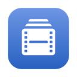
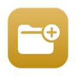

# Finder Tools

macOS utilities built by Nacho Santana for his video editing and edit-assistant workflow.

[Portfolio](https://cutbynacho.com/#personal-projects)

This repository is a public catalogue of descriptions and app icons only. It contains no source code, installers, personal settings or project templates. The tools are part of a personal setup, and some rely on locally configured helpers or templates.

## Atom Browser

Browse Avid MXF atoms as clips, preview them in IINA, and inspect multicam groups.

## Clip Info

A live clip-information window that follows your selection in Finder.

## Runtime

Calculate the total running time of selected clips or folders, with a timeline frame-rate picker.

## Timecode Changer

Batch-change timecode in MOV, MP4, MXF and WAV without re-encoding. Also edit reel names in MOV/MP4 and tape names in WAV. Creates copies by default.

## Captions to Titles

Convert captions in Final Cut Event XML into titles with matching timing, for CommandPost’s Titles to Keywords workflow. Requires Python 3.9 or newer.

## Proxy Size

Calculate proxy dimensions at 50%, 25% and standard sizes while preserving the source aspect ratio. Copy dimensions into Shutter Encoder.

## Video Tags

Add technical metadata and QC flags as Finder tags, which Final Cut can import as keywords.

## TC to Comments

Write each clip’s starting timecode into its Finder comment while preserving existing notes.

## Comment

Apply a comment to selected Finder files, replacing or appending to existing comments.

## Copy Names

Copy selected file names in natural order. Hold Option to omit file extensions.

## Projects

Create project folders and templates for Avid, Premiere and Resolve. Uses my local templates and needs configuration on another Mac.

## Usage and availability

These are desktop macOS tools, not browser applications. Catalogue entries describe the current personal builds; no public download or support commitment is implied. Projects requires configured local templates. Captions to Titles requires Python 3.9 or newer. Other tools may depend on local helpers and external utilities.

For enquiries, use the contact section on [cutbynacho.com](https://cutbynacho.com/#contact).

## Icons

The icons shown here were extracted from the existing app bundles. No rights to third-party marks or system symbols are granted.
