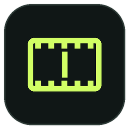
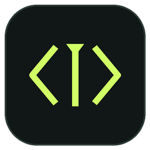

# Finder/Explorer Tools

Mac and Windows tools built by Nacho Santana for his video editing and edit-assistant workflow: Finder/Explorer tools (each entry says where it runs), plus one toolkit for DaVinci Resolve, Premiere and Final Cut Pro that works the same on Mac and Windows.

[Portfolio](https://cutbynacho.com/#personal-projects)

This repository is a public catalogue of descriptions and icons only. It contains no source code, installers, personal settings or project templates. The tools are part of a personal setup, and some rely on locally configured helpers or templates.

## Atom Browser

Browse Avid MXF atoms as clips, preview them in IINA, and inspect multicam groups. Mac and Windows.

## Clip Info

A live clip-information window that follows your selection in Finder/Explorer. Mac and Windows.

## Runtime

Calculate the total running time of selected clips or folders, with a timeline frame-rate picker. Mac and Windows.

## Timecode Changer

Batch-change timecode in MOV, MP4, MXF and WAV without re-encoding. Also edit reel names in MOV/MP4 and tape names in WAV. Creates copies by default. Mac and Windows.

## Captions to Titles

Convert captions in Final Cut Event XML into titles with matching timing, for CommandPost’s Titles to Keywords workflow. Requires Python 3.9 or newer. Mac.

## Proxy Size

Calculate proxy dimensions at 50%, 25% and standard sizes while preserving the source aspect ratio. Copy dimensions into Shutter Encoder. Mac and Windows.

## Video Tags

Add technical metadata and QC flags as Finder tags, which Final Cut can import as keywords. Mac.

## TC to Comments

Write each clip’s starting timecode into its Finder/Explorer comment while preserving existing notes. Mac and Windows.

## Comment

Apply a comment to selected Finder/Explorer files, replacing or appending to existing comments. Mac and Windows.

## Copy Names

Copy selected file names in natural order. Hold Option to omit file extensions. Mac and Windows.

## Projects

Create project folders and templates for Avid, Premiere and Resolve. Uses my local templates and needs configuration on another Mac. Mac and Windows.

## NLE Toolkit

The same set of editing, conform and delivery tools in three editors, kept in step so a job can move between them, on Mac and Windows alike: everything carries over between the two systems (Final Cut is Mac only). Icons are illustrations, not screenshots.

### Resolve tools

Scripts for DaVinci Resolve on Mac and Windows, opened from one launcher window.

- **Build Conform Reference**: a QT REF timeline with slate, 2-pops, titles, credits and watermark, plus shot labels (scale, position, rotation, FX, opacity, retime) cut exactly like the edit.
- **Check Speed Ramps**: puts the retimed clips on their own timeline next to the offline reference to spot timing errors.
- **VFX Pulls**: pulls from markers or clips with handles, versioned names and a pull list.
- **Queue Exports by Bin**: renders timelines into folders that follow their bins.
- **Batch Rename**, **Name Timeline**, **Set Start Timecode**, **Match Multicam Timecode**, **Add Head & Tail Black**, **Selected Clip Duration**.
- **Import Avid Markers** and **Import Frame.io Comments** as timeline markers.
- **Duplicate Clip Up / Down** and **jump to the next edit on all tracks**, Avid style.

### Premiere panel

One Premiere panel for Mac and Windows with the same tools: Build Conform Reference (with a labels-only update that follows In/Out), VFX Pulls through Media Encoder, Export by Bin, Batch Rename, Sequence Names, Start Timecode, Multicam Timecode, Head & Tail Black, Clip Duration, Avid Markers and Frame.io Comments. Also Adjustment Layer In to Out and Duplicate Clip Up / Down.

### Final Cut tools

The same tools for Final Cut Pro, working on an exported project and bringing the result back as a new project: Build Conform Reference, VFX Pulls, Head & Tail Black, Start Timecode, Multicam Timecode, Avid Markers, Frame.io Comments, Name Projects, Batch Rename, Project Durations and Organise Shared Exports. Runs from a drop-on app or CommandPost.

### Mac and Windows setup

One toolkit, set up the same way on a Mac or a Windows edit machine, so everything carries over between them: the Resolve tools and Premiere panel, keyboard presets, macros (Keyboard Maestro on Mac, the same macros in AutoHotkey on Windows), Stream Deck profiles and Shutter Encoder presets. Setup previews what it will change and backs up what it replaces.

## Usage and availability

These are desktop tools, not browser applications: each entry says whether it runs on Mac, Windows or both; the NLE Toolkit runs on both. Catalogue entries describe the current personal builds; no public download or support commitment is implied. Projects requires configured local templates. Captions to Titles requires Python 3.9 or newer. Other tools may depend on local helpers and external utilities.

For enquiries, use the contact section on [cutbynacho.com](https://cutbynacho.com/#contact).

## Icons

The Finder/Explorer tool icons were extracted from the existing app bundles; the NLE Toolkit icons are illustrations made for this catalogue. No rights to third-party marks or system symbols are granted.
